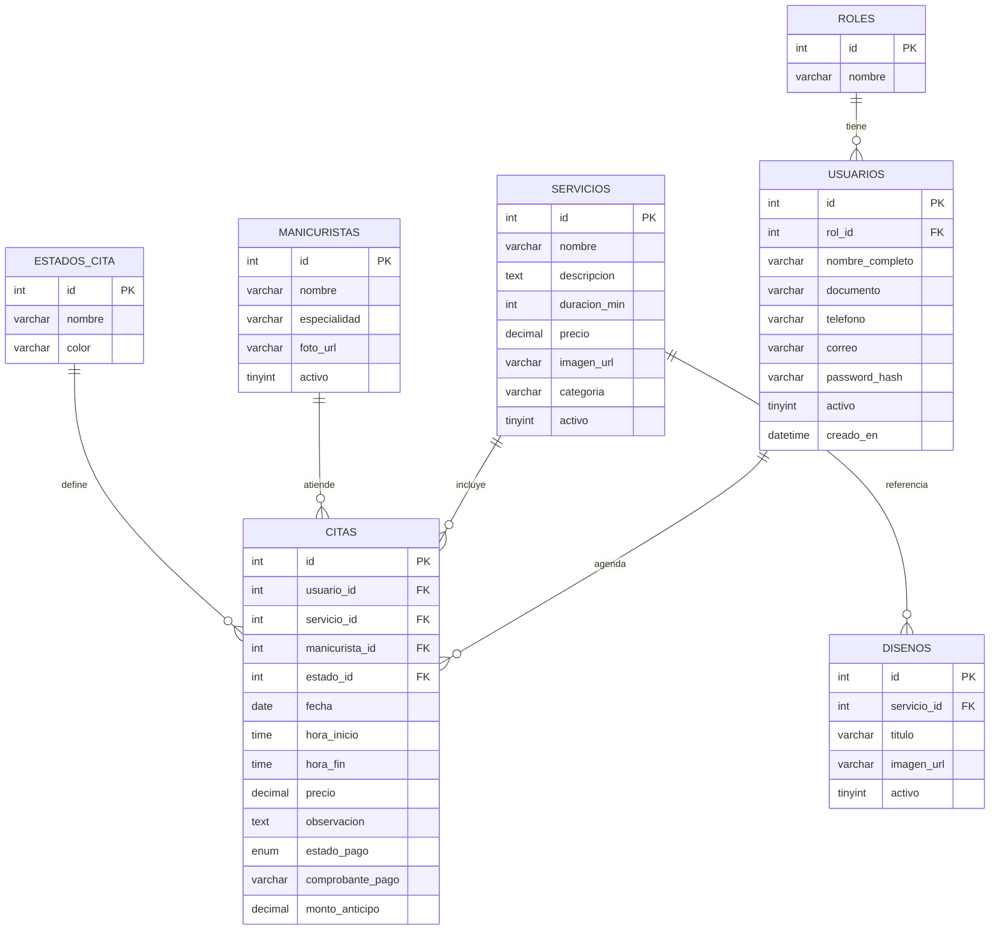

# 📚 Documentación Técnica y Evidencia de Pruebas — Glam Nails Studio & Spa

## 1. Problema Real y Pertinencia de la Solución

- **Problema:** Los salones de manicure y pedicure suelen gestionar sus citas por WhatsApp o cuaderno físico, lo que genera cruces de horarios, olvido de citas, dificultad para calcular tiempos de servicios combinados (Manicure + Pedicure), pérdida de control sobre anticipos (Nequi/Daviplata) y ausencia de reportes de ingresos por manicurista o período.
- **A quién afecta:** Clientas (esperas o incertidumbre de disponibilidad), manicuristas (desorden en su agenda) y administradora (falta de métricas reales).
- **Solución implementada:** Plataforma web SPA en React + API REST en Node.js/Express + MySQL con agenda en tiempo real tipo Google Calendar, soporte para combos de hasta 2 servicios continuos, agendas paralelas por manicurista, autogestión (reprogramar/cancelar), control de seguridad RBAC y reportes filtrables.

---

## 2. Arquitectura y Base de Datos (Modelo Entidad-Relación)

- **Frontend:** React + Vite (`frontend/src/App.jsx`, `dashboard.css`, `App.css`)
- **Backend:** Node.js + Express (`backend/src/index.js`, `routes/`, `middlewares/auth.middleware.js`)
- **Base de Datos:** MySQL (`mysql2/promise` con consultas parametrizadas)

---

## 3. Adaptación al Contexto Colombiano

- **Moneda:** Todos los precios, anticipos, KPIs y reportes operan en **Pesos Colombianos (COP)** formateados con `toLocaleString()`.
- **Medios de pago locales:** Registro de anticipos mediante referencia/comprobante de **Nequi** y **Daviplata**, diferenciando estado de pago (`pendiente`, `parcial`, `pagado`).
- **Zona horaria:** Validación de fechas en el servidor usando `America/Bogota` (`Intl.DateTimeFormat('en-CA', { timeZone: 'America/Bogota' })`) para evitar desfasamientos UTC después de las 7:00 p.m.
- **Alcance tributario (DIAN):** El sistema es una aplicación de **gestión de reservas de servicios y control interno de anticipos**; el comprobante registrado corresponde a soporte interno de reserva/anticipo y no sustituye la facturación electrónica validada ante la DIAN (Resolución 000165 de 2023), la cual aplicaría únicamente si el establecimiento supera los topes legales o emite factura electrónica mediante proveedor tecnológico autorizado.

---

## 4. Casos de Prueba Documentados

| ID | Módulo | Caso de Prueba | Entrada / Acción | Resultado Esperado | Estado |
|---|---|---|---|---|---|
| **CP-01** | Autenticación | Registro válido de clienta | Nombre solo letras, cédula numérica, teléfono válido, correo único, password ≥ 6 | Retorna HTTP `201`, password encriptado con `bcrypt`, devuelve JWT sin `password_hash` | ✅ Pasa |
| **CP-02** | Validación | Registro con datos inválidos | Nombre `"123"`, cédula `"abc"`, correo `"malo"` | Bloqueado en frontend y rechazado en backend con HTTP `400` | ✅ Pasa |
| **CP-03** | Seguridad | 5 intentos fallidos de login | 5 POST a `/api/auth/login` con clave errónea | En el 5.º intento retorna HTTP `429`, `bloqueado: true`, cierra modal de login y bloquea 15 min | ✅ Pasa |
| **CP-04** | Seguridad | Protección contra SQL Injection | Correo `' OR '1'='1` en login | Consulta parametrizada (`?`) trata el string como texto literal; no permite acceso | ✅ Pasa |
| **CP-05** | Roles (RBAC) | Clienta intenta acceder a ruta admin | `GET /api/admin/reportes` o `POST /api/admin/usuarios` con token de Clienta | Middleware `soloAdmin` rechaza con HTTP `403 Forbidden` | ✅ Pasa |
| **CP-06** | Roles (RBAC) | Crear usuario y asignar rol desde Admin | `POST /api/admin/usuarios` con `rol_id: 2` por Administradora | Crea usuario en MySQL con rol `Administradora` y permite iniciar sesión | ✅ Pasa |
| **CP-07** | Citas | Reserva en fecha pasada | Fecha anterior a hoy (`America/Bogota`) | Rechazada en frontend y backend (`400`) | ✅ Pasa |
| **CP-08** | Citas | Solapamiento de horario | Dos reservas en la misma hora con la misma manicurista | Segunda reserva rechazada con HTTP `409 Conflict` | ✅ Pasa |
| **CP-09** | Citas | Reprogramar cita | Clienta abre modal, elige nueva fecha y franja libre en calendario | `PATCH /api/citas/:id/reprogramar` actualiza fecha/hora y libera espacio anterior | ✅ Pasa |
| **CP-10** | Reportes | Reporte específico filtrado y CSV | `GET /api/admin/reportes?desde=...&hasta=...&manicurista_id=...` | Retorna totales coherentes con MySQL y descarga `.csv` UTF-8 | ✅ Pasa |
